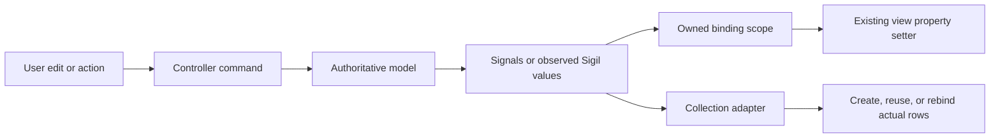

# Direct NimKit views with MVC and owned bindings

This experimental API requires an explicit `merenda/nimkit/directviews` import
and may change incompatibly without a stability promise.

A DirectView body creates or reuses NimKit views and configures them through
their existing APIs. Controllers own application operations and collection
structure, and bindings connect changes to the appropriate views.
The [DirectView roadmap](../TODO-declarative.md) tracks correctness fixes,
recovery from interrupted updates, and native application validation.

## Current prototype: collections and owned components

Run `nim ic -r examples/direct_views_demo.nim`. The demo uses the task controller
in `examples/declarative_tasks.nim` for collection updates, validation, undo and
redo, and rejecting stale drag proposals.

```nim
import merenda/nimkit
import merenda/nimkit/directviews

proc taskRow(context: DirectNode, task: Task, controller: TaskController) =
  context.viewBody:
    TextField:
      this.bindTextField(
        "title", controller.tasks.item(task.id), controller, task.id,
        titleFor, editTitle,
      )

let view = newDirectView()
view.viewBody:
  VStack:
    for task in controller.tasks{}:
      keyed(task.id):
        component(taskRow, task, controller)
```

`DirectView` owns its composition metadata. `component(builder, args...)` invokes
an ordinary procedure with a child context, giving the helper its own identity
namespace. A component has exactly one root and adds **no wrapper widget**.
Reusing a key and component builder retains that component; changing the builder
replaces it. Same-parent key/type matches retain real widgets and editors.

A component can own an independently observed body:

```nim
proc showRows(context: DirectNode, owner: TaskController, ids: seq[int]) =
  context.taskRows(owner.tasks{}, owner)

proc observedRows(context: DirectNode, owner: TaskController) =
  context.bindBody(owner.tasks.order, owner, showRows)

view.viewBody:
  VStack:
    component(observedRows, controller)
```

The component owns the subscription separately from the bindings declared by its
body. The renderer and owner are explicit; the owner and update target are weak.
Removing the component disconnects its bindings and cancels queued updates.
Releasing the root view releases the metadata tree automatically, including nested
components. Retained controls lose their action owner and become inert. A view
still retained by a window or another owner remains live; release that ownership
or call `view.clear()` when retiring its content explicitly. No application list
of sessions or custom destruction hook is required. `DirectViewSession` remains
as a lower-level compatibility API for externally owned StackView hosts.

`this` is the actual typed widget. Capitalized names map to `new<Type>()` factories;
VStack/HStack choose orientation. A Button’s first positional argument is its
title; other positional constructor arguments run **only on creation**. Named
arguments are property assignments, applied on each structural evaluation before
the optional body:

```nim
view.viewBody:
  Button("Remove", identifier = "remove"):
    this.focusable = false
  Label(stringValue = "Ready")
```

`Button(value)` and `Button(title = value)` are shorthand for a `Button:` block containing
`this.title = value`. It calls the existing typed setter, and the body can override
the value afterward. Supplying both forms for the same Button is an error;
positional arguments must precede named properties.
Use actual widget property names; constructor-only parameters can still be supplied
positionally.

Ordinary block statements run on each structural evaluation. Set
`this.arrangedSizing = svspFillAvailableWidth` in a widget body to tell the
enclosing stack how to size that widget. Custom factories create actual views.
Child arrangement currently requires StackView containers.

An inline `onAction` or `onChange` handler takes the typed widget first, followed
by the receiver and optional context. The examples call the widget parameter
`this`. Omit the context argument and its matching handler parameter when the
action only needs a receiver.

The receiver parameter can use the bound object's type or a base type such as
`Responder` or `DynamicAgent`. The bound object must still be a `Responder`.

```nim
Button("Remove"):
  this.onAction(controller, task.id) do(this: Button, owner: TaskController, id: int):
    this.enabled = false
    owner.removeTask(id)
```

Pass a named, non-capturing proc to `this.onAction(panel, apply)` or
`this.onChange(panel, update)` when the handler only needs the sender and receiver.
Each parameter can use its concrete type or a base type such as `Responder`.
See the [named callback form editor](../examples/form_editors/form_editors_procs.nim).

Use `this.onAction(receiver, apply())` or `this.onChange(receiver, textEdited())`
to send an existing action selector directly to a responder. A protocol method that
takes `ActionArgs` and returns no value provides an `ActionSelector` through
its generated accessor, such as `apply()`. The method receives the emitting
widget in `args.sender`. A variable holding an `ActionSelector` works too. See the
[protocol form editor](../examples/form_editors/form_editors_protocol.nim).

Use `this.patchText(modelTitle)` when a field should preserve the user's draft
across body updates.

```nim
TextField:
  this.patchText(modelTitle)
```

If the model title is `"Ada"` and the user has typed `"Ad"`, rerunning the body
with `"Ada"` leaves `"Ad"` in the field. If the model title changes to `"Grace"`,
`patchText` puts `"Grace"` in the field. Assign `this.stringValue` when you want
to set the text directly, for example to reset a draft.

Property ownership is explicit:

- Ordinary setters run as written. Omitting a setter leaves its previous value.
- A binding owns updates to the properties its setter writes. Omitting a binding
  disconnects it but leaves its last value; assign a replacement value explicitly.
- For TextField, `patchText` retires the previous text binding in that scope
  before writing, so the handoff cannot invoke its edit
  command. Returning from bound text resets the authored-value cache, including
  after a pass that omitted both the binding and assignment. A new `bindTextField`
  registration for the same field replaces its previous text owner in that scope.
- The positional Button title, named properties, and body setters rerun with the
  body; other positional constructor arguments run only on creation. A binding
  updates independently of the body.

The shared binding module is `nimkit/viewbindings`. `bindValue` accepts controller
signals, Sigils, and collection projections. It coalesces changes on the owning
GUI thread; `flushBindings` supports deterministic pumping. `bindTextField` adds
last-model-text tracking, programmatic-echo suppression, and an edit command routed
through a weak controller. Invalid drafts remain in the editor. External accepted
model changes replace the draft; a richer conflict/commit policy is future work.
These text handoff rules cover `bindTextField` and `patchText`;
arbitrary binding setters and independently managed scopes still require callers
to avoid competing writers.

Call `this.bindTextField(...)` or `this.bindValue(...)` to bind the widget in its
own scope.

```nim
Label:
  this.bindValue("status", controller.status) do(label: Label, value: string):
    label.stringValue = value
```

For a writable `Sigil[string]`, `this.bindTextField(id = "text", source = text)` reads
with `text{}` and writes edits back with `text <- value`. When a controller emits
its own signal, use `controller`, `signal`, and `getter` with either binding.
The getter takes the controller. For `bindTextField`, the `edit` proc takes the
controller and the edited string. For `bindValue`, the `setter` takes the widget
and the value. Pass `context` with the full binding form when a callback needs
extra data such as a task ID. See the [Sigil demo](../examples/direct_text_binding/direct_text_binding_demo.nim)
and the [explicit signal demo](../examples/direct_text_binding/direct_text_binding_signal_demo.nim).

A helper that receives a widget from a DirectView body can call `bindTextField`
or `bindValue` on that widget. For example, `form.bindTextField(...)` registers
the binding in the form's existing scope, so the form can manage a field it
creates in ordinary Nim code. Pass the target as an argument when the widget that
owns the scope and the binding target are different.
These calls raise `ValueError` if the owner has no active DirectView scope. See
the [form editor example](../examples/form_editors/form_editors_protocol.nim).

The demo uses `CollectionSigil[int, TaskItem]`. Whole snapshots drive previews and
undo, `tasks.order` drives row structure, and `tasks.item(id)` drives that row's
text. Indexed lookup avoids scanning the sequence in every getter. Unchanged rows
receive no item notification. Snapshot publication still validates/indexes O(n)
values and compares observed items. NimKit uses the collection implementation
from Sigils. See [collection contracts](collection-sigils.md).

Detached `newDirectView(detached = true)` construction uses the same component
builders with plain snapshot values, then `takeDetachedRoot()` transfers its fresh
root. Framework bindings perform initial reads without observing; actions are not
installed. Arbitrary user statements can still have side effects, so detached
mode is not a sandbox. Drag commits check their task snapshot against current
state; unrelated counters are outside that snapshot.

### Recovering from an error

A body applies setters as it runs. If a builder, setter or key check raises a
catchable error, the caller receives that error. The host may contain earlier
property changes, newly built subtrees, and controls from the previous pass. Call
`host.clear()` before composing a replacement body from the model. Clearing
retires the host's bindings and actions, including those on controls retained
by application code. For a low-level `DirectViewSession`, close the failed
session and create a fresh one.

When a queued binding getter or setter raises a catchable error,
`BindingScope.flushBindings()` attempts the remaining bindings in that scope
and then raises the first error. A still-current failed binding remains pending.
After addressing the cause, flush again to retry it. A subsequent source
notification also schedules a flush. If this happens during a GUI drain, the
remaining frame work is available on the next drain.

### Remaining limitations

- Components require one root, sibling keys and StackView arrangement. Cross-parent
  moves recreate views; offscreen/deleted editor lifetime is not solved here.
- Inline actions still allocate adapters on structural evaluation. Neither an
  allocation-count reduction nor native input latency improvement is claimed.
- Collection notifications distinguish item/order/snapshot changes; existing
  ArrayController bridges still queue coarse keyed reconciliation. Large datasets
  require TableView/CollectionView virtualization and explicit draft ownership.
- Dynamic dependencies for general bindings, formatted fields, native IME
  interactions, and undo grouping need further evaluation.
- The [two-document experiment](declarative-two-documents.md) now covers
  document-owned drafts/undo, generation-qualified commands, and revision checks
  for simulated delayed validation. External request cancellation and virtualized
  editor lifetime remain open, as does the shared layout/capture bottleneck.

## What the Figuro implementation demonstrates

Reviewed the local Figuro checkout at `b3a31768` and Merenda's Sigils dependency at
`5190b389` on 2026-11-14. Figuro's construction path is:

1. `WidgetType.new` registers a `FiguroContent` containing a typed initializer and
   a configuration callback.
2. `nodeInit[T]` calls `preNode`, which finds or creates a real widget `T`.
3. The callback runs with `this` referring to that widget. Its properties and
   child declarations configure live objects.
4. The draw sequence applies widget content/theme behavior and removes leftover
   children. `refresh` queues a widget for another evaluation.

Thus Figuro has temporary callback/child-registration records, but no complete
parallel tree of widget-property descriptions. It still performs child matching,
stores closures, and runs layout/render work. Its `draw` slot participates in UI
construction/configuration; it is not just a pixel-paint callback.
[Construction and reuse](https://github.com/elcritch/figuro/blob/b3a31768f2887057827625bf1b9910f19ff87911/src/figuro/ui/core.nim),
[widget storage](https://github.com/elcritch/figuro/blob/b3a31768f2887057827625bf1b9910f19ff87911/src/figuro/common/nodes/uinodes.nim),
[frame processing](https://github.com/elcritch/figuro/blob/b3a31768f2887057827625bf1b9910f19ff87911/src/figuro/runtime/runtimeNative.nim).

Two qualifications matter for the NimKit design:

- `preNode` matches by child position and compatible type. The supplied name is
  not used as a keyed lookup. Inserting or reordering same-type rows therefore
  does not provide our task/editor identity contract.
- Figuro has `SelectedElements[T]` and model-backed combobox examples, so it is
  not entirely without model abstractions. Those helpers use index-based
  selection, and the combobox builds every item in a loop. They do not provide
  NimKit's broader controller/data-source/editing architecture.
  [Selection model](https://github.com/elcritch/figuro/blob/b3a31768f2887057827625bf1b9910f19ff87911/src/figuro/widgets/datamodels.nim),
  [combobox implementation](https://github.com/elcritch/figuro/blob/b3a31768f2887057827625bf1b9910f19ff87911/src/figuro/widgets/combobox.nim).

The useful precedent is direct configuration of retained typed widgets with
reactive refresh. Reuse that pattern while supplying explicit identity, MVC
ownership, and binding lifetimes. This review did not run or benchmark Figuro;
its performance should motivate an experiment, not substitute for a NimKit result.

## Responsibility boundaries

| Layer | Owns | Uses |
| --- | --- | --- |
| Model/document/controller | Authoritative data, commands, validation, undo, selection and ordering policy. | Plain values, existing model-controller APIs, signals, and selected reactive properties. |
| Direct-view composition | Real view creation/reuse, child identity/order, and removal. | Typed widget factories, existing setters, structural slots and explicit keys. |
| Binding scope | Dependencies, connection lifetime, current receiver/item context, and queued updates. | Sigils signals/slots and optionally tracked `Sigil[T]` reads. |
| Table/collection adapter | Data-source/delegate integration and row/cell scope lifetime. | Stable model IDs and existing TableView/CollectionView infrastructure. |
| Widget/editor | Drawing, layout, input, provisional text, selection, and IME composition. | Existing NimKit control and field-editor behavior. |



Composition tracks child keys, widget types, binding identities, connections, and
selected last-authored values. It uses that metadata to reuse widgets and keep
their bindings current.

## The direct-view execution contract

Keep `viewBody` and capitalized widget names as the authoring direction. In this
variant their meaning changes: a node obtains a real typed view in a composition
scope, then its block operates on that view. Ordinary widget properties retain
their existing getter/setter boundary. New controls should participate through
typed factory/configuration hooks rather than a central description-kind enum.

Use three kinds of work with distinct lifetimes:

- **Initialization:** create the widget and perform one-time view setup.
- **Value binding:** reevaluate a particular value or small configuration block
  when its inputs change, then apply the necessary property update.
- **Structural update:** reevaluate conditional children or collection membership,
  match existing widgets, reorder them in place, and retire absent ones.

A counter update should normally run its value binding, not replay row factories.
Figuro-like configuration-block reevaluation remains useful for related properties,
but the invalidation scope must be explicit. Reexecuting a parent must not reset
an existing child's editor, reinstall duplicate handlers, or accidentally treat
every child as newly initialized.

Keep structural slots for fixed siblings and explicit keys for repeated children.
A type mismatch creates a replacement; a matching entity/type preserves its view.
Do not copy Figuro's positional matching as the identity policy for mutable lists.
Unspecified properties also need a policy: a binding owns the properties it writes;
conditional removal of a binding must explicitly restore a default or transfer
ownership, rather than leaving an accidental stale value.

Direct execution changes validation possibilities. For the first list prototype,
obtain and validate the complete sibling-ID sequence from the model before changing
its views. Arbitrary nested declarations cannot promise whole-description
duplicate-key validation before any mutation merely by checking keys as they run.
That broader guarantee needs a structural preflight/staging contract, or must remain
a reported compatibility gap. Setter failures likewise do not imply rollback.

## What Sigils supplies, and what the binding layer adds

`Sigil[T]` stores an observable value. In a `bindSigilEvents(receiver)` block, a
`sigil{}` read connects that Sigil's `change` signal to the receiver's `recompute`
slot. Figuro implements `recompute` by requesting refresh. Ordinary fields on an
Agent/controller are not automatically observable, and this mechanism does not
intercept arbitrary Nim property reads.
[Current reactive implementation](https://github.com/elcritch/sigils/blob/5190b389ef7448adfc591924d80ad3a971e3487b/sigils/reactive.nim).

Use two source forms behind the same binding ownership contract:

1. **Controller signals with an explicit getter.** A typed binding names the
   relevant change signal and reads current data through the controller. This
   works with existing plain models and structured model-mutation notifications.
2. **Observed `Sigil[T]` inputs.** A binding reads genuinely reactive values or
   computed values. Use this where observation is useful, such as an independent
   counter or derived display state, without wrapping every View field in a Sigil.

Avoid storing both an authoritative plain field and an independently writable
Sigil copy. A reactive projection is read-only with writes routed to the controller,
or the Sigil itself owns that particular value. Selection and collection storage
should likewise have one owner.

Each binding needs a defined record/contract, regardless of its eventual syntax:

- A stable binding identity within the owning view/row scope.
- A weak controller/receiver and explicit value context, such as a task ID.
- A typed read operation and a typed target-property write operation.
- An optional accepted-edit command, including validation/undo policy.
- Owned subscriptions, pending/active state, and a generation for reuse/teardown.
- A last authored value where needed to distinguish a model change from a local edit.

The root view owns its composition state. A mounted row owns its row bindings; those
bindings do not strongly capture the owning controller or keep a removed view alive.
Retain bindings while the same row identity moves. When reusing a widget for a new
entity, disconnect its old dependencies and refresh context before it can emit an
edit. A queued update for an old generation must be ignored. Releasing the root view
disconnects subscriptions and makes externally retained controls inert.

The current `bindSigilEvents` helper adds connections when reads execute; it does
not reconcile an old dependency set with a new one when a conditional branch
switches. Automatic conditional dependencies therefore need a scoped read-collection
and replacement mechanism, or explicit reconnection when source/context changes.
Do not disconnect all observers on a shared widget/model to achieve this: remove
only the connections owned by that binding. This may justify a focused Sigils
extension, but it is not already a complete composition runtime.

Initially use explicit controller dependencies for structural changes and a small
fixed-input Sigil binding for the counter. Add dynamic read-set replacement as a
separate behavior step. Coalesce invalidations on the owning GUI thread, provide
a deterministic flush, and defer invalidations raised during a flush to a defined
subsequent pass. Worker results must reach that thread through existing dispatch
mechanisms; signals must not patch widgets on an arbitrary emitting thread.

## MVC supplies the collection boundary

The layout body should create/configure one TableView or CollectionView. A model
controller/data source supplies item IDs, content, sorting/filtering, and selection.
A delegate or presenter configures actual row/cell views. The body does not have to
enumerate the entire dataset into child declarations on each model change.

Existing integration points include TableView's `viewForCell` and collection
`viewForCollectionItem`/`configureCollectionItemView`. Row configuration can itself
use the direct-view DSL, with a binding scope whose context is the entity ID.
Keep table/collection ownership of internal rows separate from the outer layout's
ownership of the table/collection widget.
[Table protocols](../src/merenda/nimkit/tables/tablecore.nim),
[collection protocols](../src/merenda/nimkit/containers/collectionviews.nim).

The model-to-view adapter translates changes at two granularities:

- **Item fields:** update the affected visible bindings; account for fields that
  also influence sorting, filtering, or row geometry.
- **Membership/order:** obtain the new visible ID ordering and reconcile row
  identities, preserving selection, the editing entity, and the viewport anchor.

`CollectionRows` connects an `ArrayController` to a `CollectionView` and builds
DirectView rows for a bounded viewport. See the [editable collection example](../examples/direct_collection_demo.nim)
and [adapter](../src/merenda/nimkit/directviews/collectionrows.nim). Its builder
receives the stable model identifier; use that identifier for bindings and actions.
The collection owns the adapter as its delegate, so call `rows.close()` before
replacing the delegate or releasing the collection. Model updates are coalesced on
the GUI thread; tests and synchronous callers can use `rows.flushBindings()`.

CollectionView materializes rows intersecting the viewport plus half a viewport of
vertical content above and below it. `visibleItemIndexes` still reports the actual
viewport; `materializationItemIndexes` reports the buffered range. Mounted views
can additionally include a retained editor. An active field editor remains mounted
when its row leaves that range; other rows outside it are recycled. Removing the edited identifier cancels its editor and
retires its bindings before an identifier can be reused. Selection is synchronized
with the controller. At most one editing row is retained outside the buffered range.
Virtualization does not require either experimental layout cache flag.

On macOS, `tests/integrations/nativecomposition.nim` covers the Cocoa marked-text
callbacks and caret/selection queries through a native window. To additionally
exercise the Japanese input method, use an unlocked desktop session, select the
Japanese Romaji input source, and run that test with
`MERENDA_TEST_JAPANESE_IME=1`. Restore your usual input source afterwards.

ArrayController's insert/remove/move notifications currently share `mmkItemsChanged`,
and source indexes are not necessarily sorted/filtered presentation indexes. Begin
with keyed order comparison; introduce precise deltas only with a clear contract.
A typed domain controller can implement the same data-source hooks without copying
all application state into a second `ModelItem` store.
[Model controllers](../src/merenda/nimkit/app/modelcontrollers.nim).

CollectionView retains items by identity; TableView delegates can opt into retained
hosted cells with `configureCellView`. Tests cover editor identity across insert/move.
Applications still need a model policy for drafts that must outlive an editor.
[Collection updates](../src/merenda/nimkit/containers/collectionviews.nim),
[table updates](../src/merenda/nimkit/tables/tablerows.nim).

## Editing and actions

A binding is more than a getter/setter pair. Distinguish the model's accepted value,
the editor's provisional text, and any validation error. Support explicit live-change
and accepted-commit policies using existing formatting/validation protocols. An
unrelated model notification must not push old text back into an active editor.
Echoing the user's accepted value must preserve selection and marked text; conflicting
external changes need a stated policy. Selected last-authored-value storage can
provide this without retaining an entire view description.
[TextField behavior](../src/merenda/nimkit/text/textfields.nim).

Keep inline ActionTarget handlers for local behavior and named controller commands
for menu/keyboard/button reuse. Install a handler once per binding identity and
update its explicit context on rebind. Preserve weak receivers and disable handlers
before removal/reuse. An expired explicit target must not turn into an unintended
responder-chain command. Ordinary event callbacks run outside dependency collection.
Controller operations perform validation, undo registration, and model mutation;
programmatic property patches do not reissue those operations.

## Retained lifetime and visibility

Hiding a retained `DirectView` does not suspend its bindings. Model changes still
update its widgets, so showing it again exposes current state. `clear()` instead
retires the content, disconnects its scopes and makes retained old control actions
inert, including work queued before the clear. The host can then compose a fresh
body from the current model. Drafts that must survive this operation belong to an
editor or document, outside the widget tree.

Presentation detachment and document closure are separate domain operations.
An editor generation can reject obsolete validation results without cancelling a
document-owned save. Neither hiding a view nor releasing its bindings automatically
cancels external work. No application-maintained session list is required.

Call `suspendUpdates()` explicitly to pause a DirectView's structural and property
bindings while retaining its widgets and subscriptions. Queued writes are revoked;
notifications accumulate as pending changes. `resumeUpdates()` reads those sources
at their current values, with structural parents applied before their surviving
children. It does not replay intermediate values. Sources must still notify when
changed; unsignaled mutations are not detected. Text-edit commands and ordinary
action callbacks remain enabled, so drafts continue to belong to the controller:
suspension pauses model-to-view refresh, not command dispatch.

Composition must finish before suspension. Explicit composition while suspended
raises `ValueError`; `clear()` retires the content and preserves the host's paused
state. Both operations are idempotent where applicable. For controller-owned
visibility policy, [direct_lifetimes_demo.nim](../examples/direct_lifetimes_demo.nim)
connects `didDisappear` to suspension and `willAppear` to resumption. Hiding a view
without that explicit policy continues to leave its bindings active.

See the executable coverage in
[directlifetimes.nim](../tests/nimkit/directlifetimes.nim) and the form experiment in
[form_editors_protocol.nim](../examples/form_editors/form_editors_protocol.nim).

## Dragology previews

`newDeclarativeDragView` accepts a builder returning `View`.
[Drag controller](../src/merenda/nimkit/interaction/dragcontrollers.nim).

Use the same direct-view layout/configuration code against a fresh detached scope
and a plain model snapshot. Binding reads resolve once from snapshot data; live
subscriptions, actions, and application lifecycle effects are not installed. Table
previews need an isolated read-only data source with matching columns/geometry,
not the live model controller and its mutation subscriptions. Custom factories
need an explicit preview-safe construction contract.

This still creates widgets and performs layout/capture. It does not eliminate the
solver budget or full-candidate cost. Preserve capture-validity checks and commit
accepted operations against current model state, so a preview cannot restore an
outdated unrelated value. Sharing live widgets or editors with candidates is excluded.

## Experimental virtualized rows

`newCollectionRows(collection, controller, builder)` uses an ArrayController as
its data source and composes each mounted row into a DirectView. The builder is
called with the stable model identifier and can use the ordinary DirectView DSL
and scope-owned bindings. The adapter observes model and selection changes;
`flushBindings` may be used to apply queued changes explicitly on the GUI thread.
Call `close` when replacing the adapter or disposing its presentation.

Rows outside the viewport are cleared before their host is reused, including
bindings and action targets. A row containing the window's active field editor
stays mounted offscreen, retaining its provisional text, marked text and
selection. The next viewport reconciliation retires it after editing ends.
Removing the item cancels its field editor and retires the row. A model or
controller must own any draft that must survive the end of editing or a row's
retirement; row identity is not a durable draft or asynchronous validity token.
The adapter uses the collection's delegate and expects unique, stable item IDs.

The adapter applies the controller's selection mode before its selected IDs.
Clearing the view selection or toggling its last selected item off also clears
the controller selection. Programmatic selection changes through either preserve
the active editor, including when revealing the selected row scrolls it offscreen.
Pointer selection requests focus for the collection and follows the window's normal
end-editing and validation behavior.

Compile with `-d:merendaProfile` and import
`merenda/nimkit/foundation/viewprofiling` to reset and read thread-local phase
counters. Times are inclusive: solving includes construction and insertion, and
intrinsic measurement may occur inside generation. Do not add the phase times.
The profiler also reports exclusive times, excluding nested instrumented phases;
the remaining uninstrumented work stays in its enclosing phase. Constraint
insertion includes the solver's incremental optimization. Variable update is
timed separately and only writes the already solved values.
The drawing phase covers view draw callbacks, not GPU presentation. Solver size
is the maximum recorded per pass; these counters are diagnostics, not a memory
or input-latency measurement.
