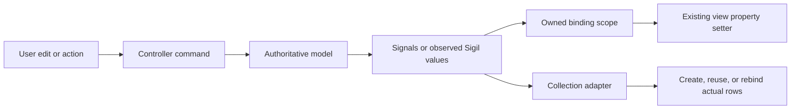

# Proposal: direct NimKit views with MVC and owned bindings

This is the proposed P7 experiment in [the declarative design comparison](../TODO-declarative.md#proposed-alternative-prototypes).
It does not construct a `ViewSpec` tree. A declaration finds or creates actual
NimKit views and configures them through their existing APIs. Controllers own
application operations and collection structure; bindings connect changes to the
appropriate live views. This is a design proposal, not an implemented API or a
performance result.

## What the Figuro implementation demonstrates

Reviewed the local Figuro checkout at `b3a31768` and Merenda's Sigils dependency at
`5190b389` on 2026-11-14. Figuro's construction path is:

1. `WidgetType.new` registers a `FiguroContent` containing a typed initializer and
   a configuration callback.
2. `nodeInit[T]` calls `preNode`, which finds or creates a real widget `T`.
3. The callback runs with `this` referring to that widget. Its properties and
   child declarations configure live objects.
4. The draw sequence applies widget content/theme behavior and removes leftover
   children. `refresh` queues a widget for another evaluation.

Thus Figuro has temporary callback/child-registration records, but no complete
parallel tree of widget-property descriptions. It still performs child matching,
stores closures, and runs layout/render work. Its `draw` slot participates in UI
construction/configuration; it is not just a pixel-paint callback.
[Construction and reuse](https://github.com/elcritch/figuro/blob/b3a31768f2887057827625bf1b9910f19ff87911/src/figuro/ui/core.nim),
[widget storage](https://github.com/elcritch/figuro/blob/b3a31768f2887057827625bf1b9910f19ff87911/src/figuro/common/nodes/uinodes.nim),
[frame processing](https://github.com/elcritch/figuro/blob/b3a31768f2887057827625bf1b9910f19ff87911/src/figuro/runtime/runtimeNative.nim).

Two qualifications matter for the NimKit design:

- `preNode` matches by child position and compatible type. The supplied name is
  not used as a keyed lookup. Inserting or reordering same-type rows therefore
  does not provide our task/editor identity contract.
- Figuro has `SelectedElements[T]` and model-backed combobox examples, so it is
  not entirely without model abstractions. Those helpers use index-based
  selection, and the combobox builds every item in a loop. They do not provide
  NimKit's broader controller/data-source/editing architecture.
  [Selection model](https://github.com/elcritch/figuro/blob/b3a31768f2887057827625bf1b9910f19ff87911/src/figuro/widgets/datamodels.nim),
  [combobox implementation](https://github.com/elcritch/figuro/blob/b3a31768f2887057827625bf1b9910f19ff87911/src/figuro/widgets/combobox.nim).

The useful precedent is direct configuration of retained typed widgets with
reactive refresh. Reuse that pattern while supplying explicit identity, MVC
ownership, and binding lifetimes. This review did not run or benchmark Figuro;
its performance should motivate an experiment, not substitute for a NimKit result.

## Responsibility boundaries

| Layer | Owns | Uses |
| --- | --- | --- |
| Model/document/controller | Authoritative data, commands, validation, undo, selection and ordering policy. | Plain values, existing model-controller APIs, signals, and selected reactive properties. |
| Direct-view composition | Real view creation/reuse, child identity/order, and removal. | Typed widget factories, existing setters, structural slots and explicit keys. |
| Binding scope | Dependencies, connection lifetime, current receiver/item context, and queued updates. | Sigils signals/slots and optionally tracked `Sigil[T]` reads. |
| Table/collection adapter | Data-source/delegate integration and row/cell scope lifetime. | Stable model IDs and existing TableView/CollectionView infrastructure. |
| Widget/editor | Drawing, layout, input, provisional text, selection, and IME composition. | Existing NimKit control and field-editor behavior. |

No layer needs a complete `ViewSpec` tree. Some metadata remains necessary:
child keys/type compatibility, binding identity, connections, and selected last
authored values. That metadata describes ownership and synchronization rather than
every property and child in a second view representation.

## The direct-view execution contract

Keep `viewBody` and capitalized widget names as the authoring direction. In this
variant their meaning changes: a node obtains a real typed view in a composition
scope, then its block operates on that view. Ordinary widget properties retain
their existing getter/setter boundary. New controls should participate through
typed factory/configuration hooks rather than a central description-kind enum.

Use three kinds of work with distinct lifetimes:

- **Initialization:** create the widget and perform one-time view setup.
- **Value binding:** reevaluate a particular value or small configuration block
  when its inputs change, then apply the necessary property update.
- **Structural update:** reevaluate conditional children or collection membership,
  match existing widgets, reorder them in place, and retire absent ones.

A counter update should normally run its value binding, not replay row factories.
Figuro-like configuration-block reevaluation remains useful for related properties,
but the invalidation scope must be explicit. Reexecuting a parent must not reset
an existing child's editor, reinstall duplicate handlers, or accidentally treat
every child as newly initialized.

Keep structural slots for fixed siblings and explicit keys for repeated children.
A type mismatch creates a replacement; a matching entity/type preserves its view.
Do not copy Figuro's positional matching as the identity policy for mutable lists.
Unspecified properties also need a policy: a binding owns the properties it writes;
conditional removal of a binding must explicitly restore a default or transfer
ownership, rather than leaving an accidental stale value.

Direct execution changes validation possibilities. For the first list prototype,
obtain and validate the complete sibling-ID sequence from the model before changing
its views. Arbitrary nested declarations cannot promise P0's whole-description
duplicate-key validation before any mutation merely by checking keys as they run.
That broader guarantee needs a structural preflight/staging contract, or must remain
a reported compatibility gap. Setter failures likewise do not imply rollback.

## What Sigils supplies, and what the binding layer adds

`Sigil[T]` stores an observable value. In a `bindSigilEvents(receiver)` block, a
`sigil{}` read connects that Sigil's `change` signal to the receiver's `recompute`
slot. Figuro implements `recompute` by requesting refresh. Ordinary fields on an
Agent/controller are not automatically observable, and this mechanism does not
intercept arbitrary Nim property reads.
[Current reactive implementation](https://github.com/elcritch/sigils/blob/5190b389ef7448adfc591924d80ad3a971e3487b/sigils/reactive.nim).

Use two source forms behind the same binding ownership contract:

1. **Controller signals with an explicit getter.** A typed binding names the
   relevant change signal and reads current data through the controller. This
   works with existing plain models and structured model-mutation notifications.
2. **Observed `Sigil[T]` inputs.** A binding reads genuinely reactive values or
   computed values. Use this where observation is useful, such as an independent
   counter or derived display state, without wrapping every View field in a Sigil.

Avoid storing both an authoritative plain field and an independently writable
Sigil copy. A reactive projection is read-only with writes routed to the controller,
or the Sigil itself owns that particular value. Selection and collection storage
should likewise have one owner.

Each binding needs a defined record/contract, regardless of its eventual syntax:

- A stable binding identity within the owning view/row scope.
- A weak controller/receiver and explicit value context, such as a task ID.
- A typed read operation and a typed target-property write operation.
- An optional accepted-edit command, including validation/undo policy.
- Owned subscriptions, pending/active state, and a generation for reuse/teardown.
- A last authored value where needed to distinguish a model change from a local edit.

The controller owns the root session. A mounted row owns its row bindings; those
bindings do not strongly capture the owning controller or keep a removed view alive.
Retain bindings while the same row identity moves. When reusing a widget for a new
entity, disconnect its old dependencies and refresh context before it can emit an
edit. A queued update for an old generation must be ignored. Destroying the session
disconnects subscriptions and makes externally retained controls inert.

The current `bindSigilEvents` helper adds connections when reads execute; it does
not reconcile an old dependency set with a new one when a conditional branch
switches. Automatic conditional dependencies therefore need a scoped read-collection
and replacement mechanism, or explicit reconnection when source/context changes.
Do not disconnect all observers on a shared widget/model to achieve this: remove
only the connections owned by that binding. This may justify a focused Sigils
extension, but it is not already a complete composition runtime.

Initially use explicit controller dependencies for structural changes and a small
fixed-input Sigil binding for the counter. Add dynamic read-set replacement as a
separate behavior step. Coalesce invalidations on the owning GUI thread, provide
a deterministic flush, and defer invalidations raised during a flush to a defined
subsequent pass. Worker results must reach that thread through existing dispatch
mechanisms; signals must not patch widgets on an arbitrary emitting thread.

## MVC supplies the collection boundary

The layout body should create/configure one TableView or CollectionView. A model
controller/data source supplies item IDs, content, sorting/filtering, and selection.
A delegate or presenter configures actual row/cell views. The body does not have to
enumerate the entire dataset into child declarations on each model change.

Existing integration points include TableView's `viewForCell` and collection
`viewForCollectionItem`/`configureCollectionItemView`. Row configuration can itself
use the direct-view DSL, with a binding scope whose context is the entity ID.
Keep table/collection ownership of internal rows separate from the outer layout's
ownership of the table/collection widget.
[Table protocols](../src/merenda/nimkit/tables/tablecore.nim),
[collection protocols](../src/merenda/nimkit/containers/collectionviews.nim).

The model-to-view adapter translates changes at two granularities:

- **Item fields:** update the affected visible bindings; account for fields that
  also influence sorting, filtering, or row geometry.
- **Membership/order:** obtain the new visible ID ordering and reconcile row
  identities, preserving selection, the editing entity, and the viewport anchor.

This adapter is missing glue, not something `bindTableView` already completes.
ArrayController's insert/remove/move notifications currently share `mmkItemsChanged`,
and source indexes are not necessarily sorted/filtered presentation indexes. Begin
with keyed order comparison; introduce precise deltas only with a clear contract.
A typed domain controller can implement the same data-source hooks without copying
all application state into a second `ModelItem` store.
[Model controllers](../src/merenda/nimkit/app/modelcontrollers.nim).

Some underlying behavior needs improvement too. CollectionView currently clears
all item slots during its update operations. Table row updates recycle cell slots,
although they also contain selection/editing-ID preservation logic. Neither path
alone proves that a hosted custom TextField keeps its exact editor through a move.
Fix and test those shared mechanisms rather than conceal resets in the binding DSL.
[Collection updates](../src/merenda/nimkit/containers/collectionviews.nim),
[table updates](../src/merenda/nimkit/tables/tablerows.nim).

## Editing and actions

A binding is more than a getter/setter pair. Distinguish the model's accepted value,
the editor's provisional text, and any validation error. Support explicit live-change
and accepted-commit policies using existing formatting/validation protocols. An
unrelated model notification must not push old text back into an active editor.
Echoing the user's accepted value must preserve selection and marked text; conflicting
external changes need a stated policy. Selected last-authored-value storage can
provide this without retaining an entire view description.
[Existing text patch policy](../src/merenda/nimkit/declarative/mounts.nim),
[TextField behavior](../src/merenda/nimkit/text/textfields.nim).

Keep inline ActionTarget handlers for local behavior and named controller commands
for menu/keyboard/button reuse. Install a handler once per binding identity and
update its explicit context on rebind. Preserve weak receivers and disable handlers
before removal/reuse. An expired explicit target must not turn into an unintended
responder-chain command. Ordinary event callbacks run outside dependency collection.
Controller operations perform validation, undo registration, and model mutation;
programmatic property patches do not reissue those operations.

## Dragology does not require ViewSpec

`newDeclarativeDragView` already accepts a builder returning `View`. The current
demo happens to call `buildDetachedView(ViewSpec)` inside that callback, but this
is one way to satisfy the API, not a requirement of Dragology.
[Drag controller](../src/merenda/nimkit/interaction/dragcontrollers.nim).

Use the same direct-view layout/configuration code against a fresh detached scope
and a plain model snapshot. Binding reads resolve once from snapshot data; live
subscriptions, actions, and application lifecycle effects are not installed. Table
previews need an isolated read-only data source with matching columns/geometry,
not the live model controller and its mutation subscriptions. Custom factories
need an explicit preview-safe construction contract.

This still creates widgets and performs layout/capture. It does not eliminate the
solver budget or full-candidate cost. Preserve capture-validity checks and commit
accepted operations against current model state, so a preview cannot restore an
outdated unrelated value. Sharing live widgets or editors with candidates is excluded.

## First experiment and evidence required

Keep P0 as the reference. Implement P7 in logical steps, with a commit after each:

1. Direct typed creation/reuse and removal for a small eager keyed list. Retain the
   existing editor identity tests and document structural validation limitations.
2. Owned bindings: one Sigil counter, one controller-signaled row title, explicit
   row-ID context, coalesced flush, and teardown/reuse with queued work.
3. Controller commands and editing: validation rejection, accepted-edit undo,
   programmatic echo, external changes, and action context after reordering.
4. The same layout code constructing isolated Dragology candidates from snapshots.
5. A table/collection adapter, measured separately with a fixed viewport after the
   relevant shared cell/item identity behavior is corrected.

Measure against the same semantic contract and workload, including layout. Count
body/binding executions, handler creations, connections and retained memory; measure
actual allocations before characterizing them as expensive. No-op updates, repeated
source switching, and long-lived row recycling must not grow subscription counts.
Then assess authoring complexity and compile-time diagnostics as well as timings.

The main hypothesis is that real-view composition plus MVC-owned bindings provides
the needed expressiveness with less intermediate representation and narrower update
work. Whether it is faster, simpler, and more robust than P0/P2 remains the result
this experiment must establish.
